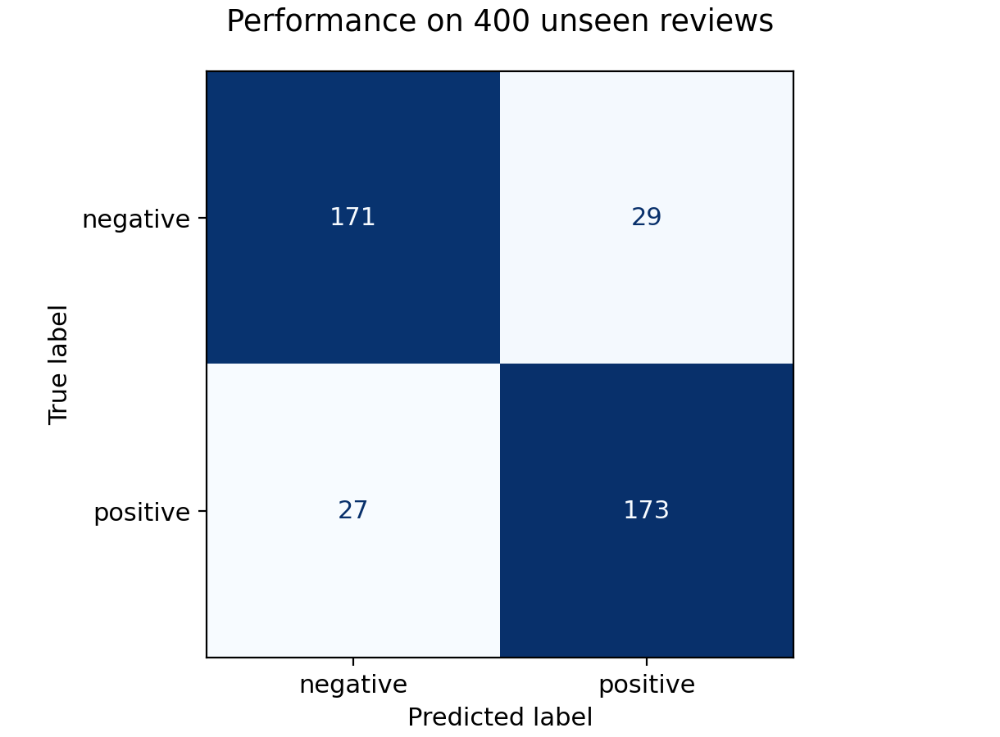

# Movie Review Sentiment Analysis

Viorel Binciu | Artificial Intelligence course project | 20 November 2026

## 1. Project overview

This project predicts whether an English movie review expresses a positive or negative opinion. It uses supervised machine learning: the model learns from reviews with known labels and then predicts labels for new text.

The goal is to build a small, understandable system with a working demo and a clear evaluation. The user enters a review in a Streamlit interface and receives a sentiment prediction with the model scores for both classes.

## Connection to the course

The project applies natural language processing, learning patterns from data, logistic regression and performance evaluation. These topics appear in the supplied Artificial Intelligence course. It demonstrates a data-driven approach rather than manually listing every possible rule for a positive or negative review.

## Dataset

The experiment uses the Cornell sentiment polarity dataset v2.0, released in June 2004 by Bo Pang and Lillian Lee. It contains 2,000 processed movie reviews: 1,000 positive and 1,000 negative. The labels describe the overall sentiment of each review.

The original archive is kept unchanged in the project. Its README and the dataset attribution are preserved. A SHA-256 checksum verifies that the training script uses the same archive as this experiment.

| Training set | Test set | Measured accuracy |
| --- | --- | --- |
| 1,600 reviews | 400 unseen reviews | 86.0% |

## 2. Method

The dataset is split into 80% training data and 20% test data with a fixed random seed of 42. Stratification keeps the classes balanced: 800 reviews per class for training and 200 per class for testing. The exact filenames in each split are saved.

## Representing text with TF-IDF

TF-IDF converts text into numeric features. A term receives more weight when it appears in a review but is less common across the training collection. This implementation uses sublinear term frequency, so repeated words have a smaller additional effect.

Features include single words and pairs of adjacent words. Keeping word pairs helps represent local expressions, including some forms of negation. Stop words are retained so words such as "not" are available to the model.

| TF-IDF setting | Value |
| --- | --- |
| Lowercase | Enabled |
| Word range | Single words and word pairs |
| Minimum document frequency | 2 training reviews |
| Maximum document frequency | 95% of training reviews |
| Maximum features | 20,000 |
| Sublinear term frequency | Enabled |

## Classification with logistic regression

Logistic regression learns a weight for each text feature and combines the weighted features with a bias. A sigmoid function turns this linear score into an estimated probability for the positive class. The model predicts the class with the higher score.

The classifier uses C = 1.0, the liblinear solver and a limit of 1,000 iterations. A scikit-learn pipeline joins TF-IDF and the classifier. Both are fitted only on training reviews, so the test text does not influence the vocabulary or inverse document frequencies.

## Evaluation protocol

The settings were fixed before inspecting test performance. This project uses one holdout split and does not reproduce the original paper's cross-validation protocol. A classifier that always predicts one class provides a 50% accuracy baseline on the balanced test set.

## 3. Results

The trained pipeline correctly classified 344 of the 400 test reviews, giving 86.0% accuracy. It made 56 mistakes. The macro F1 score was 0.860, compared with a 50.0% accuracy baseline for always choosing one class.

| Class | Precision | Recall | F1 score | Reviews |
| --- | --- | --- | --- | --- |
| Negative | 0.864 | 0.855 | 0.859 | 200 |
| Positive | 0.856 | 0.865 | 0.861 | 200 |

Of the 200 negative reviews, 171 were classified correctly and 29 were labeled positive. Of the 200 positive reviews, 173 were classified correctly and 27 were labeled negative.

## Interpreting the results

Precision measures how often a predicted class is correct. Recall measures how many actual reviews of that class are found. F1 combines precision and recall. The similar class scores suggest that this split does not strongly favor one sentiment.

Learned negative features include "bad", "worst" and "boring". Learned positive features include "great", "the best" and "perfect". These are associations in the training data, not rules that always determine the meaning of a review.

## 4. Demo and discussion

Start the demo with: python -m streamlit run app.py. Enter an English review or choose one of the three built-in examples, then click Analyze review. The interface displays a positive or negative prediction and the estimated score for each class. Empty text and text with no known features receive a helpful message.

## Limitations

- There is no neutral class. Mixed or neutral reviews are still forced into one of the two available classes.

- The model learns local word patterns. Sarcasm, long-distance negation and contrasting opinions can be difficult.

- The dataset contains older English reviews. Results may differ for modern slang, short comments, other languages or non-movie text.

- The output scores have not been separately calibrated. They are estimates for one review, not the measured accuracy of the system.

- The original data README notes that some rating information may remain in the texts. Labels were derived from ratings, which also limits how they should be interpreted.

- One holdout split cannot fully describe performance. The result is not directly comparable with studies using other splits or validation protocols.

## Conclusion and next steps

TF-IDF with logistic regression provides a compact baseline for this task. On the fixed test split, it achieved 86.0% accuracy and performed above the majority-class baseline. Future work could compare a neural network, use cross-validation within the training data, and evaluate separately on newer reviews. A neutral class would require suitable labeled data.

## References

Supplied course: Curs 1 - Notiuni fundamentale, Artificial Intelligence, 2022 edition; course syllabus and natural language processing applications.

Pang, B. and Lee, L. (2004). A Sentimental Education: Sentiment Analysis Using Subjectivity Summarization Based on Minimum Cuts. ACL. Cornell dataset v2.0: https://www.cs.cornell.edu/people/pabo/movie-review-data/

scikit-learn documentation: TfidfVectorizer and LogisticRegression. https://scikit-learn.org/stable/

Streamlit documentation: forms and application interface. https://docs.streamlit.io/
